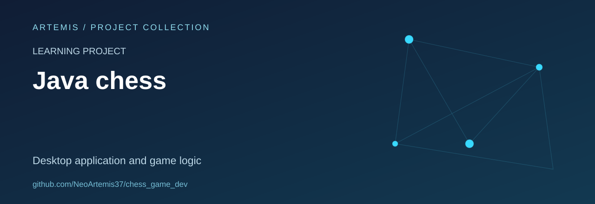
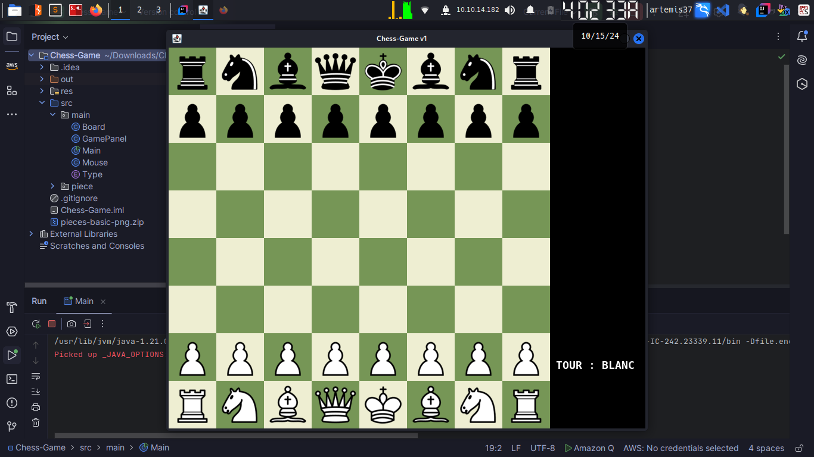
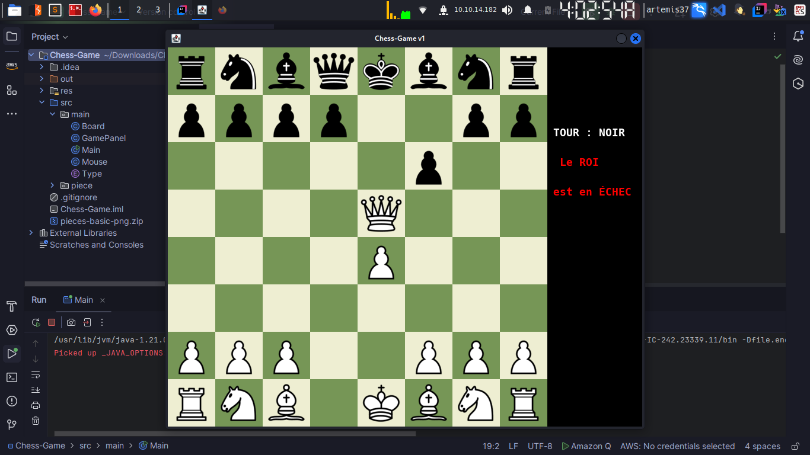

# Java Chess

A local two-player chess project built with Java Swing, exploring object-oriented game logic and interactive desktop interfaces.

**Status:** learning project. **Stack:** Java, Swing and Java2D.

## What is included

- A window and game loop in `Chess-Game/src/main/`.
- Separate piece classes for pawns, rooks, knights, bishops, queens and kings.
- Board rendering, mouse interaction and code paths for move validation, promotion, castling and end-of-game checks.
- Piece artwork in `Chess-Game/res/piece/`.

The presence of these code paths is not a claim of complete chess-rule conformance. There is no automated rules test suite in this snapshot.

## Screenshots

## Explore the source

Start with [`Main.java`](Chess-Game/src/main/Main.java), then [`GamePanel.java`](Chess-Game/src/main/GamePanel.java) and the classes in [`src/piece/`](Chess-Game/src/piece/).

Open the project in a Java IDE and keep `res/` available on the runtime classpath. The repository includes an IntelliJ project file, but no Maven or Gradle build. A supported JDK version has not yet been documented.

## Next improvements

- Add a reproducible build and a small rules test suite.
- Document the origin and licence of the piece artwork.
- Keep generated `.class` files outside the source repository.

## Reuse

No repository-wide licence file is included in this snapshot. Source and artwork provenance should be clarified before redistribution.
